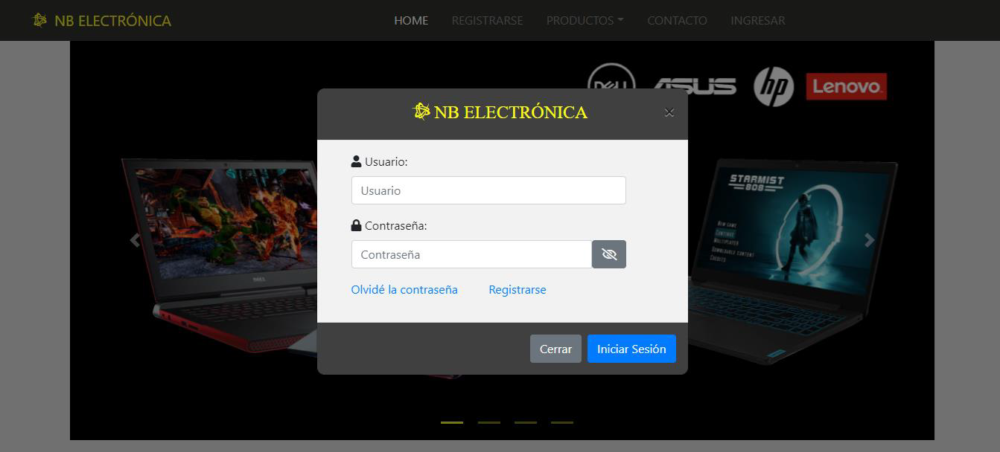
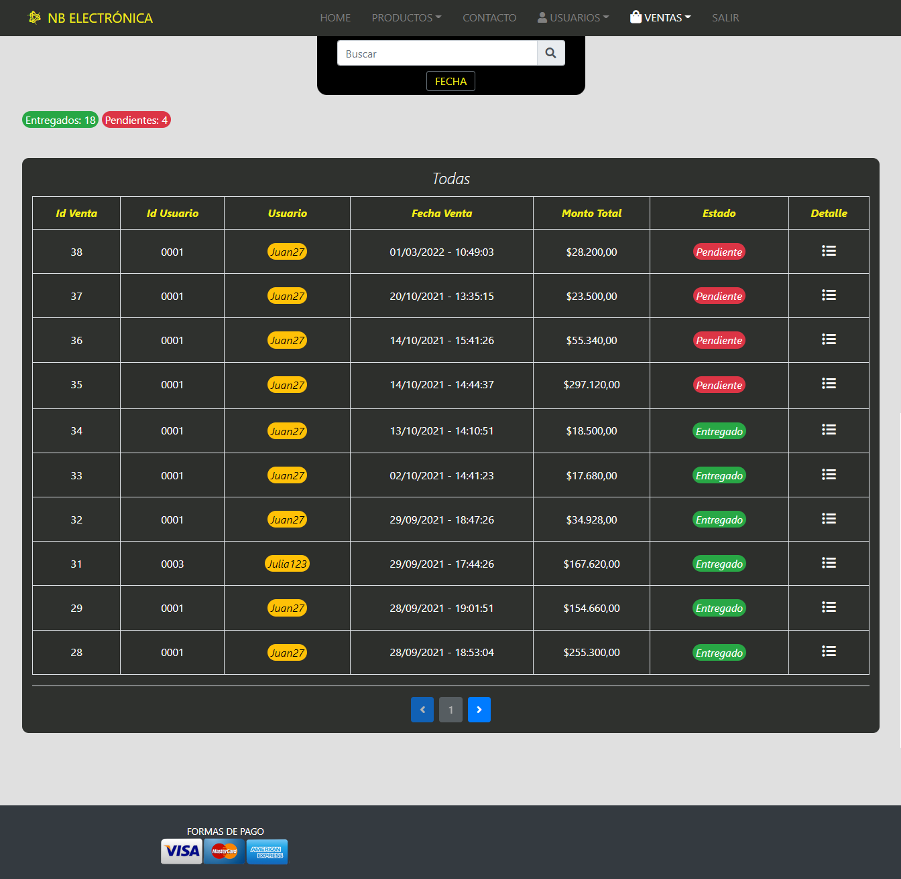
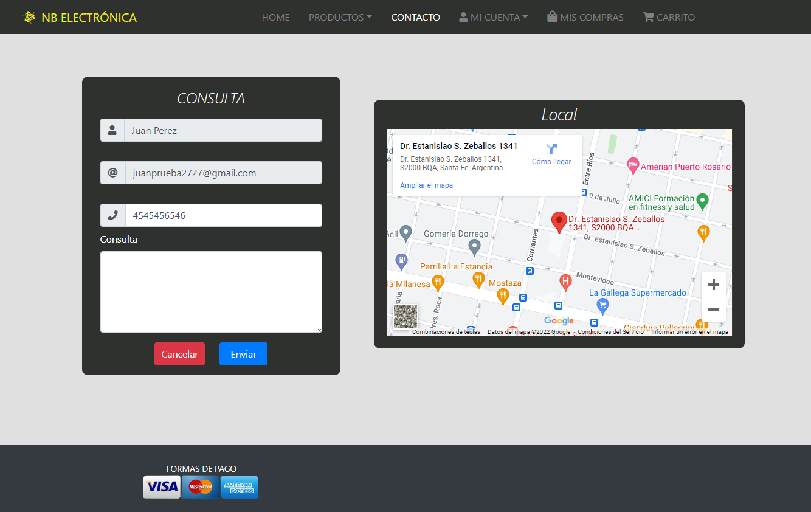
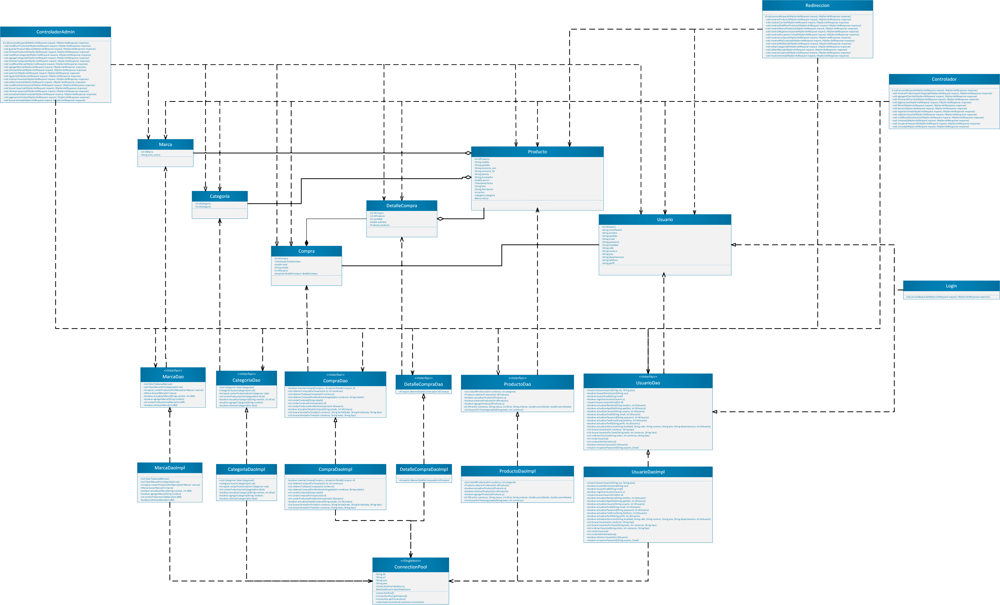
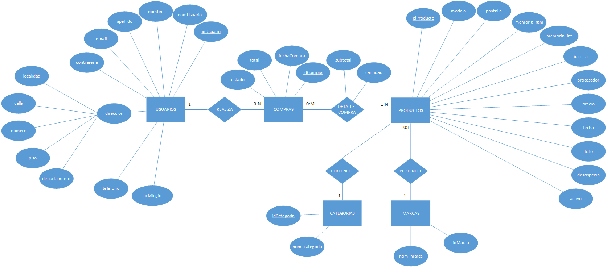

# 🛒 Sistema de Gestión de Inventario y Ventas

> Aplicación web full-stack Java EE para comercialización de productos electrónicos con gestión integral de inventario, usuarios y ventas.



---

## 📌 Descripción

Sistema completo de e-commerce y gestión administrativa orientado a comercios electrónicos. Permite:

- **Gestionar operaciones comerciales** en tiempo real
- **Controlar inventario** automáticamente
- **Procesar ventas** de forma eficiente
- **Administrar usuarios** y permisos
- **Generar reportes** para toma de decisiones

Arquitectura escalable y robusta construida con patrones de diseño modernos (MVC, DAO, Singleton).

---

## 🚀 Funcionalidades Principales

### 📦 Gestión de Productos
- Alta, baja y modificación de productos
- Gestión de categorías y marcas
- Control dinámico de precios
- Visualización detallada de productos


### 💳 Ventas y Carrito
- Carrito de compras interactivo
- Procesamiento de órdenes de compra
- Generación de pedidos
- Seguimiento de transacciones




### 👥 Administración de Usuarios
- Gestión de clientes y administradores
- Roles y permisos diferenciados
- Recuperación de contraseñas
- Modificación de perfiles


### 📊 Consultas y Reportes
- Filtros avanzados por producto, categoría y marca
- Visualización de datos consolidados
- Generación de reportes



---

## 🛠️ Tecnologías Utilizadas

### Backend
- **Java EE**: Servlets y JSP.
- **Arquitectura MVC**: Separación de lógica, datos y vista.
- **Patrón DAO**: Acceso a datos encapsulado.
- **Servidor**: GlassFish v5.1.

### Frontend
- **HTML5, CSS3, JavaScript**.
- **Bootstrap v4.5**: Diseño responsivo.
- **Font Awesome**: Iconografía.

### Base de Datos
- **MariaDB / MySQL**: Almacenamiento relacional.
- **Procedimientos Almacenados**: Optimización de consultas complejas.
- **Connection Pool**: Gestión eficiente de conexiones (Patrón Singleton).

---

## 🧱 Arquitectura y Diseño

El proyecto implementa patrones de diseño profesionales:

### Patrón MVC
```
┌──────────────────────┐
│   CONTROLADOR        │ ◄─── Recibe solicitudes HTTP
│    (Servlets)        │      Valida y orquesta lógica
└──────────┬───────────┘
           │
      ┌────▼──────┐
      │  MODELO   │ ◄─── Acceso a datos (DAO)
      │   (DAO)   │      Lógica de negocio
      └────┬──────┘
           │
      ┌────▼──────┐
      │   VISTA   │ ◄─── Presentación (JSP)
      │   (JSP)   │      Respuesta al usuario
      └───────────┘
```

### Componentes Clave
- **DAO (Data Access Object):** Encapsulación del acceso a datos
- **Connection Pool:** Gestión eficiente de conexiones (Patrón Singleton)
- **Validación:** Entrada segura y consistente
- **Procedimientos Almacenados:** Optimización de consultas complejas

#### Diagrama de Clases


#### Diagrama Entidad-Relación


---

## 📁 Estructura del Proyecto

```
sistema-inventario-ventas/
├── 📂 web-app/                    # Aplicación Java Web
│   ├── src/java/
│   │   ├── 🖥️  controlador/      # Servlets - Lógica de solicitudes
│   │   ├── 🗂️  modelo/           # Clases de entidades
│   │   └── 🗄️  modelo_Dao/       # Acceso a datos
│   ├── web/
│   │   ├── 🎨 css/              # Estilos (Bootstrap, custom)
│   │   ├── 🖼️  img/             # Imágenes de productos
│   │   ├── 📄 *.jsp             # Vistas dinámicas
│   │   └── 🔗 js/               # JavaScript (jQuery, Bootstrap)
│   ├── libs/                     # Dependencias .jar
│   └── 🔨 build.xml             # Configuración Ant
│
├── 📂 db/
│   └── 📋 Base de datos.sql      # Script SQL completo
│
├── 📂 docs/
│   ├── 🏗️  diagrams/            # Diagramas técnicos
│   │   ├── class-diagram.png
│   │   └── entity-relationship.png
│   └── 📸 images/               # Capturas de pantalla
│
└── 📄 README.md                  # Este archivo
```

---

## 💻 Requisitos Previos

- **Java JDK 8+**
- **GlassFish 5.1** (servidor de aplicaciones)
- **MariaDB / MySQL 5.7+**
- **Ant** (herramienta de compilación)
- **Git** (control de versiones)

---

## 📦 Instalación

### 1. Clonar el Repositorio
```bash
git clone https://github.com/NBailone/sistema-inventario-ventas.git
cd sistema-inventario-ventas
```

### 2. Configurar la Base de Datos
```bash
# Acceder a MariaDB/MySQL
mysql -u root -p

# Importar el script de base de datos
source db/Base\ de\ datos.sql
```

### 3. Compilar el Proyecto
```bash
cd web-app
ant build
```

### 4. Desplegar en GlassFish
```bash
# Iniciar GlassFish
asadmin start-domain

# Desplegar la aplicación
asadmin deploy --contextroot=inventario dist/inventario.war
```

### 5. Acceder a la Aplicación
- **URL:** `http://localhost:8080/inventario`
- **Admin:** Usuario predeterminado según configuración en BD

---

## 🔐 Seguridad

- ✅ **Autenticación de usuarios** con roles diferenciados
- ✅ **Validación de entrada** en todas las operaciones
- ✅ **Gestión de sesiones** segura
- ✅ **Recuperación de contraseñas** con validaciones
- ✅ **Encapsulación de datos** mediante DAO

---

## ☁️ Despliegue en Producción

La aplicación fue desplegada exitosamente en **Jelastic**, un entorno cloud que:

- ✅ Permite acceso remoto sin infraestructura local
- ✅ Garantiza escalabilidad automática
- ✅ Proporciona alta disponibilidad
- ✅ Facilita pruebas en entorno similar a producción

---

## 🏆 Habilidades Demostrables

### Backend
- ✅ Java EE (Servlets, JSP)
- ✅ Patrones de Diseño (MVC, DAO, Singleton)
- ✅ Programación Orientada a Objetos
- ✅ JDBC y Connection Pooling
- ✅ Procedimientos Almacenados SQL

### Frontend
- ✅ HTML5, CSS3, JavaScript Vanilla
- ✅ Bootstrap (Diseño Responsivo)
- ✅ Integración Frontend-Backend
- ✅ UX/UI aplicado

### Base de Datos
- ✅ Modelado relacional (DER)
- ✅ MariaDB / MySQL
- ✅ Procedimientos almacenados
- ✅ Optimización de consultas

### DevOps
- ✅ GlassFish (Servidor de Aplicaciones)
- ✅ Ant (Build Automation)
- ✅ Despliegue en Cloud (Jelastic)
- ✅ Control de Versiones (Git)

---

## 👨‍💻 Autor

**Nicolas Bailone**

- 🔗 GitHub: [@NBailone](https://github.com/NBailone)
- 📧 Contacto: [nbailone@gmail.com]

---
